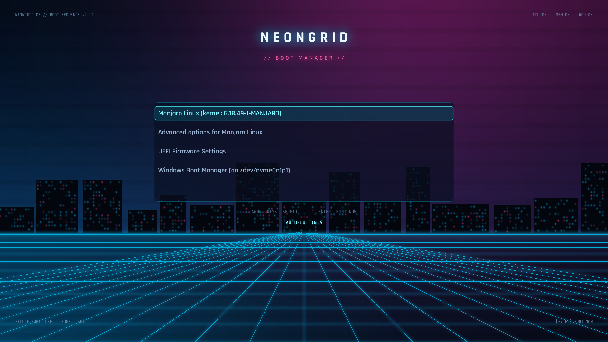
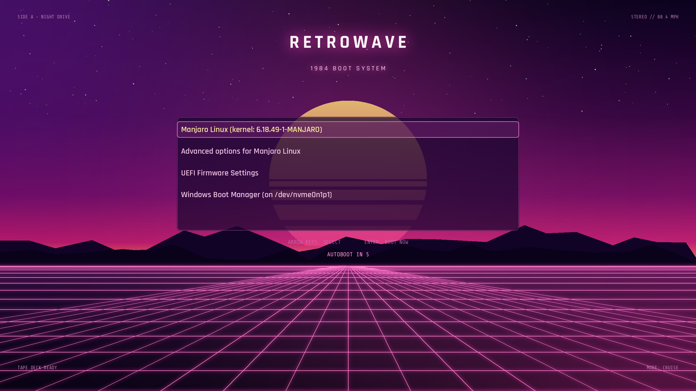
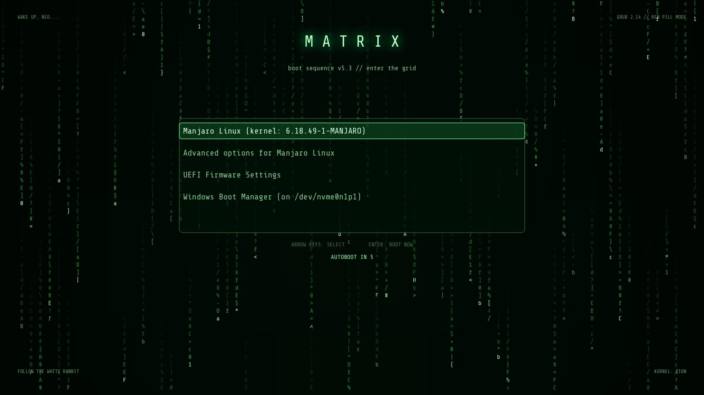
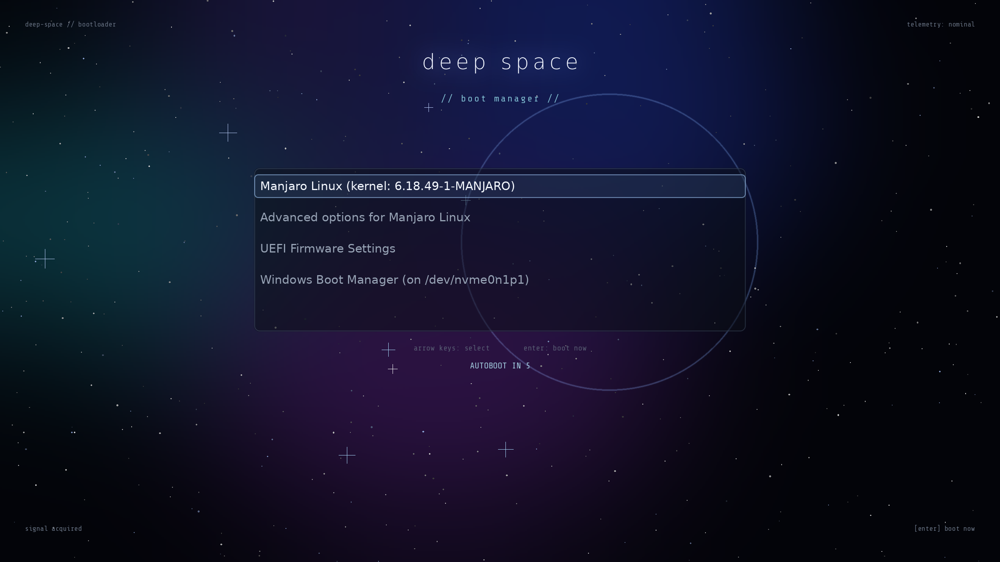
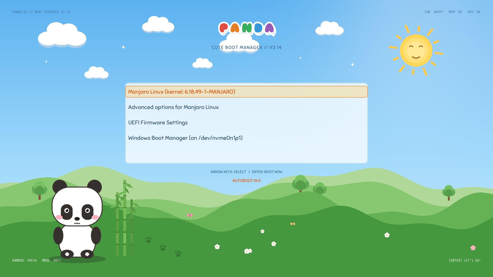
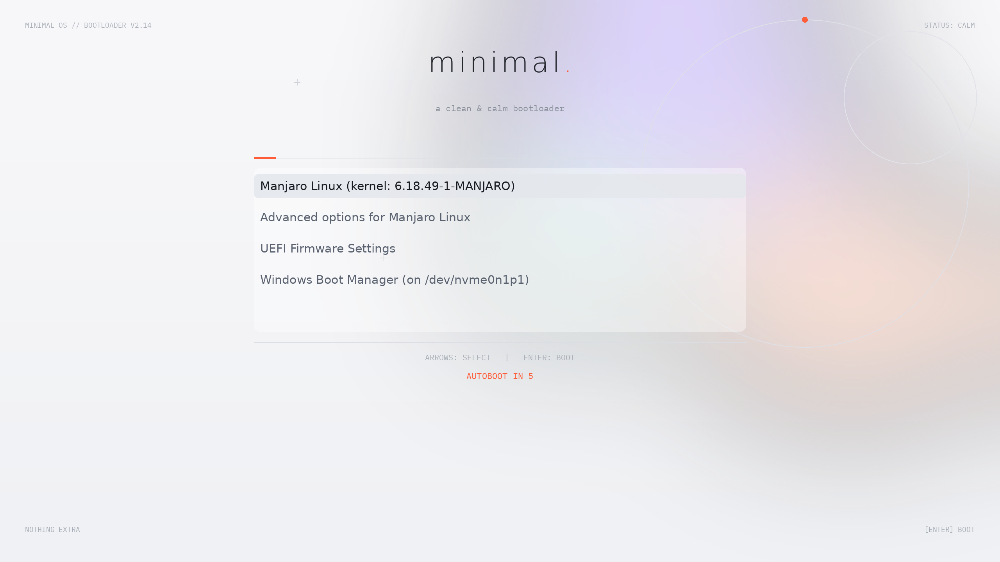
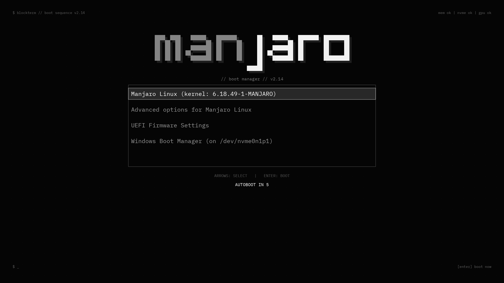

# 🎨 grub-themes · 7 套手绘风 GRUB2 开机主题

为 2560×1440 屏幕原生设计的 GRUB2 图形主题，每一套的背景、字体、配色、菜单面板都是程序化绘制 + 手工调校的，不是网图套壳。

> 赛博朋克 · 复古合成波 · 黑客帝国 · 深空星野 · 卡通熊猫 · 极简 · 终端方块

| 主题 | 风格 |
|---|---|
| [neongrid](#1-neongrid-赛博朋克) | 霓虹城市 + 透视网格 |
| [retrowave](#2-retrowave-复古合成波) | 1984 落日 + 山脉剪影 |
| [matrix](#3-matrix-黑客帝国) | 绿色代码雨 + 终端字体 |
| [nebula](#4-nebula-深空星野) | 星云 + 星野 + 辉光 |
| [panda](#5-panda-卡通熊猫) | Q 版熊猫 + 青山竹丛 |
| [clean](#6-clean-极简) | 粉彩极光 + 发丝线排版 |
| [blockterm](#7-blockterm-终端方块) | 方块像素字 + 终端面板 |

## 预览

### 1. neongrid · 赛博朋克
霓虹城市天际线、青色透视网格地平线，品红 × 青双色辉光，Rajdhani 科技字体。



### 2. retrowave · 复古合成波
扫描线落日、山脉剪影、粉色网格， Miami 配色。



### 3. matrix · 黑客帝国
满屏绿色代码雨、扫描线、Share Tech Mono 终端字体。



### 4. nebula · 深空星野
深空星云、星野与十字星芒，辉光标题。



### 5. panda · 卡通熊猫
Q 版三头身小熊猫、笑脸太阳、双层云影、四层景深青山、竹丛、爪印与蝴蝶，Sniglet 圆胖字体彩色标题。



### 6. clean · 极简
薰衣草紫→蜜桃橙→薄荷绿的柔焦极光渐变，细线圆环与发丝分割线，珊瑚橙点缀。



### 7. blockterm · 终端方块
灵感来自 opencode 的 logo：纯黑底、方块像素字双色 wordmark（man 灰 / jaro 白）、终端光标块、细灰边框方角面板，IBM Plex Mono 等宽字体。



## 环境要求

- GRUB 2.06+（已在 Manjaro / GRUB 2.14 上验证）
- UEFI + gfxterm 启动
- 主题按 **2560×1440** 设计；`install.sh` 会设置 `GRUB_GFXMODE=2560x1440,1920x1080,auto`，不支持 1440p 的机器会自动降级到 1080p（文字等比偏小但布局居中不受影响）

## 安装

```bash
git clone https://github.com/duruoxian/grub-themes.git
cd grub-themes
sudo ./install.sh            # 交互式选择
sudo ./install.sh blockterm  # 或直接指定主题名
```

脚本会自动：备份 `/etc/default/grub` → 复制主题到 `/boot/grub/themes/` → 设置 `GRUB_THEME` / `gfxterm` / `GRUB_GFXMODE` → 重新生成 `grub.cfg`。重启即可看到效果。

<details>
<summary>手动安装</summary>

```bash
sudo cp -r blockterm /boot/grub/themes/
```

编辑 `/etc/default/grub`：

```
GRUB_THEME="/boot/grub/themes/blockterm/theme.txt"
GRUB_GFXMODE=2560x1440,1920x1080,auto
GRUB_TERMINAL_OUTPUT=gfxterm
```

```bash
sudo grub-mkconfig -o /boot/grub/grub.cfg
```

</details>

## 切换 / 恢复 / 卸载

- **切换主题**：再跑一次 `sudo ./install.sh <另一个主题名>` 即可
- **恢复安装前的配置**：每次运行 `install.sh` 都会备份 `/etc/default/grub` 到 `/etc/default/grub.bak-时间戳`：

  ```bash
  sudo cp /etc/default/grub.bak-时间戳 /etc/default/grub
  sudo grub-mkconfig -o /boot/grub/grub.cfg
  ```

- **彻底卸载**：删除主题目录、去掉 `GRUB_THEME` 行并重新生成：

  ```bash
  sudo rm -rf /boot/grub/themes/主题名
  sudo sed -i '/^GRUB_THEME=/d' /etc/default/grub
  sudo grub-mkconfig -o /boot/grub/grub.cfg
  ```

## 自定义

每套主题的背景都由 [gen.py](gen.py) 程序化绘制（Pillow），改配色、标题文字、菜单位置只需编辑 `gen.py` 里对应主题的配置，然后：

```bash
python3 gen.py blockterm          # 只重新生成 blockterm（需 Pillow 与 grub-mkfont）
sudo cp -r blockterm /boot/grub/themes/
```

各主题的布局/配色集中在 `gen.py` 的 `THEMES` 配置里，改起来很直观。

> ⚠️ **兼容性说明**：GRUB ≥ 2.12 的新主题解析器不支持 `left = 50% - 630` 这类百分比算术写法——会报 `expected "=" after property name` 并**静默回退**到无主题菜单。本仓库全部使用纯像素坐标，你自己在写主题时也请注意。

## 字体授权

| 字体 | 用途 | 授权 |
|---|---|---|
| Rajdhani | neongrid / retrowave 标题与菜单 | SIL OFL 1.1 |
| Sniglet | panda 标题与菜单 | SIL OFL 1.1 |
| Share Tech Mono | HUD 小字 / matrix | SIL OFL 1.1 |
| IBM Plex Mono | clean / blockterm | SIL OFL 1.1 |

## License

[MIT](LICENSE) © duruoxian
